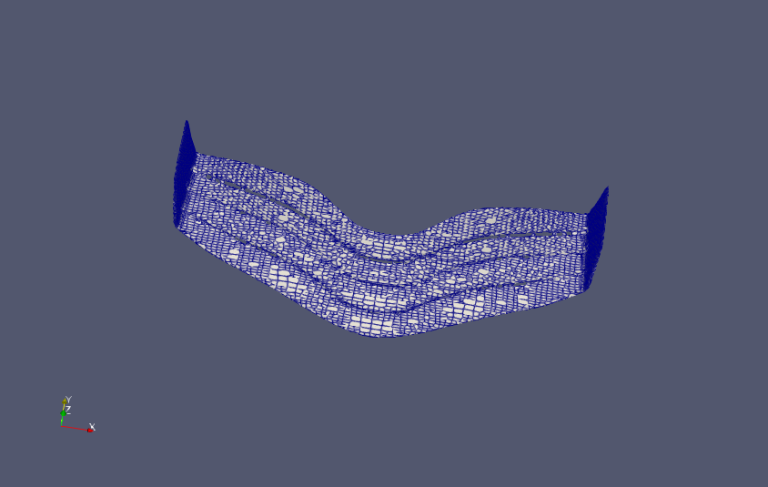

# F1 Front Wing — CFD in OpenFOAM

Steady-state RANS simulation of an F1-style front wing, built end to end in OpenFOAM: geometry cleanup, hex-dominant meshing with `snappyHexMesh`, solver configuration, and post-processing in ParaView.



## Scope

This project covers geometry preparation, meshing, mesh-quality assessment and solver configuration. Initial `simpleFoam` runs showed decreasing residuals, but the solve was not carried through to convergence, so no force coefficients are reported.

## Pipeline

1. **Geometry:** the wing STL was cleaned and merged into a single watertight surface (`f1wing_single.stl`). Feature edges were extracted with `surfaceFeatures`.
2. **Background mesh:** `blockMesh` builds a uniform 80 × 80 × 40 hex domain.
3. **Surface-snapped mesh:** `snappyHexMesh` refines to levels 3–4 on the wing surface and level 4 inside a refinement box around it, then snaps to the geometry.
4. **Mesh quality:** `checkMesh` was run on the final mesh (see the table below).
5. **Solve:** `simpleFoam` (steady, incompressible) with the k–ω SST turbulence model.
6. **Post-processing:** pressure and velocity slices in ParaView; the `forceCoeffs` function object is configured for lift and drag.

## Mesh

| Metric | Value |
|---|---|
| Cells | 4,443,036 |
| Max non-orthogonality | 70.0° (average 5.0°), passes |
| Max aspect ratio | 18.0, passes |
| Max skewness | 8.2 (13 highly skewed faces) |
| Concave cells | 53,475 |

Non-orthogonality is close to OpenFOAM's 70° threshold, so the solver uses one non-orthogonal corrector (`nNonOrthogonalCorrectors 1`). The skewness and concave-cell warnings are non-fatal. They are concentrated at the snapped surface and are the main target for the next meshing iteration.

## Solver setup

| Setting | Choice | Reason |
|---|---|---|
| Solver | `simpleFoam` (SIMPLEC, `consistent yes`) | Steady incompressible flow at 50 m/s (Mach ≈ 0.15) |
| Turbulence | k–ω SST | Handles adverse pressure gradients and near-wall flow better than k–ε |
| Convection | `bounded Gauss upwind` (first order) | Robust starting point: numerical diffusion damps oscillations on a first mesh |
| Gradients / Laplacian | `Gauss linear` / `Gauss linear corrected` | Second order, with correction for non-orthogonality |
| Relaxation | 0.9 on all equations | Stable with SIMPLEC |
| Inlet / outlet | Fixed 50 m/s / zero gradient | Uniform freestream |
| Wing | No-slip wall | |

## Repository layout

```
f1-wing-case/            main case
  system/                blockMeshDict, snappyHexMeshDict, fvSchemes, fvSolution, controlDict
  0/                     initial and boundary conditions
  constant/triSurface/   wing geometry (STL)
  logs/checkMesh.log     mesh quality report
  docs/                  devlogs and images
pitzDailySteady-case/    earlier prototype case, kept for reference
```

## Running it

```bash
cd f1-wing-case
surfaceFeatures
blockMesh
snappyHexMesh -overwrite
checkMesh
simpleFoam
```

## Possible extensions

- Run `simpleFoam` to convergence and report lift and drag coefficients.
- Switch convection schemes to second order (`linearUpwind`) once the first-order solution is converged.
- Reduce skewed and concave cells at the wing surface (snapping and layer controls).
- Add near-wall prismatic layers and check y+.
- Run a mesh-independence study.
